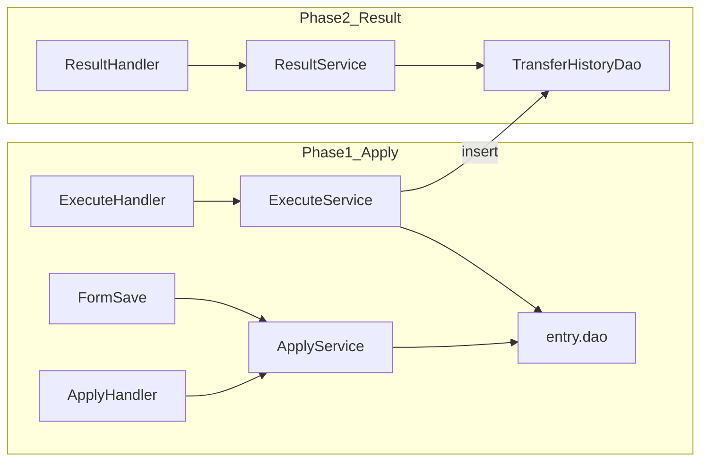

# 급여이체 구현 계획서 (2단계)

패키지: `salary.transfer`  
DAO: `salary.entry.dao`에 추가  
스타일: entry / ledger JSP 톤

---

## 공통 (1·2단계 공유)

### Enum

`salary.transfer.TransferColumn`

- `code` ↔ `transfer_form_item.item_code`
- `label` = 화면 표시명
- 후보: 구분, 사번, 성명, 영문, 부서, 직위, 입사일, 휴대폰, 이메일, 금융기관, 계좌, 지급합계, 공제합계, 실지급액

### 계좌 소스


| 용도    | 테이블                           | 컬럼                                                |
| ----- | ----------------------------- | ------------------------------------------------- |
| 회사 출금 | `payroll_information`         | `salary_bank`, `salary_account`, `account_holder` |
| 사원 입금 | `employee_information_salary` | `salary_bank`, `salary_account`                   |


### 더미 SQL

`sql/transfer_dummy.sql` (1단계 전에 준비)

- `payroll_information` 출금계좌
- 사원 `employee_information_salary` 입금계좌
- 기본 `transfer_form` + `transfer_form_item`
- 필요 시 기존 `salary` / `salary_date`와 맞춤

DB 직접 insert는 구현 시 승인 후 sqlplus로 진행.

---

## 1단계: 급여이체 신청

### 목표

메뉴 `/salary/transfer/apply.do` 동작  
양식 설정 + 동적 컬럼 목록 + **급여이체하기** → `transfer_history` insert

### URL

```properties
/salary/transfer/apply.do=salary.transfer.command.TransferApplyHandler
/salary/transfer/form/save.do=salary.transfer.command.TransferFormSaveHandler
/salary/transfer/execute.do=salary.transfer.command.TransferExecuteHandler
```

### 화면

- 필터: 귀속연월, 급여차수, 이체양식
- 좌측: 양식 선택 / 신규명 / Enum 항목 추가·순서·삭제 / 저장
- 우측: `visibleColumns` 순서 동적 테이블 + 합계(지급/공제/실지급)
- 버튼: **급여이체하기만** (결재/인쇄/엑셀 제외)

### 신청 목록 조인

```
salary_date + salary + employee
  + department + position
  + employee_information_salary
  + payroll_information (출금계좌)
```

### 패키지 (1단계)


| 구분      | 클래스                                                                         |
| ------- | --------------------------------------------------------------------------- |
| enum    | `TransferColumn`                                                            |
| viewdto | `TransferApplyData`, `TransferApplyRow`                                     |
| command | `TransferApplyHandler`, `TransferFormSaveHandler`, `TransferExecuteHandler` |
| service | `TransferApplyService`, `TransferExecuteService`                            |


### DAO (entry.dao, 1단계)


| DAO                  | 역할                                 |
| -------------------- | ---------------------------------- |
| `SalaryDao` 확장       | 연월·차수별 이체신청 조인 조회                  |
| `SalaryDateDao`      | 기존 `selectByPeriod` 등 재사용          |
| `TransferFormDao`    | form / item 조회·저장                  |
| `TransferHistoryDao` | insert (+ 중복 확인용 selectBySalaryId) |


### 이체 실행 규칙

1. 필터 payYear/Month/Seq로 목록 조회
2. 입금계좌 없으면 해당 행 skip
3. 이미 성공 이력 있는 `salary_id` skip
4. `transfer_date` = 오늘
5. 출금 = 회사 payroll, 입금 = 사원 eis, 금액 = `net_pay`
6. `deposit_memo` 예: `급여2026-08`
7. `transfer_result` = `성공`

### 1단계 완료 기준

- [ ] 연월·차수 변경 시 급여 대상 목록 표시
- [ ] 양식 저장 후 새로고침해도 항목·순서 유지
- [ ] 선택한 컬럼만 테이블에 표시
- [ ] 이체하기 후 `transfer_history` 행 생성 (결과 화면은 2단계)

### 1단계 작업 순서

1. Enum + DAO + 더미 SQL
2. 신청 조회 Handler/Service/JSP
3. 양식 저장
4. 이체 실행

---

## 2단계: 급여이체 결과조회

### 목표

메뉴 `/salary/transfer/result.do`  
이체일자 범위로 `transfer_history`만 조회

### URL

```properties
/salary/transfer/result.do=salary.transfer.command.TransferResultHandler
```

### 화면

- 필터: 조회 기간 (from ~ to) + 검색
- 테이블: 이체일자, 출금은행/계좌, 입금은행/계좌, 예금주, 이체금액, 받는분 통장 표시, 처리결과
- 조인 없음 (`transfer_history` 단독)
- 페이징: 전체 목록 또는 최소 UI

### 패키지 (2단계 추가)


| 구분      | 클래스                                    |
| ------- | -------------------------------------- |
| viewdto | `TransferResultData` (또는 Row 리스트 + 기간) |
| command | `TransferResultHandler`                |
| service | `TransferResultService`                |


### DAO

- 1단계 `TransferHistoryDao`에 `selectByDateRange(conn, from, to)` 추가

### 2단계 완료 기준

- [ ] 기간 검색으로 1단계에서 넣은 이체 건 표시
- [ ] 데이터 없을 때 empty 메시지

### 2단계 작업 순서

1. History 일자 범위 조회 DAO
2. Result Service/Handler/JSP
3. URI 등록 + 신청→결과 흐름 확인

---

## 아키텍처 (단계별)




## 의도적으로 안 하는 것 (공통)

- 결재란 / 인쇄 / 엑셀
- 이체 배치 헤더 테이블
- `salary.transfer.dao` 패키지
- 결과조회용 FK 조인

## 진행 방식

1. **1단계만** 구현·검증 (신청 + 이체 insert)
2. 확인 후 **2단계** 결과조회 구현

